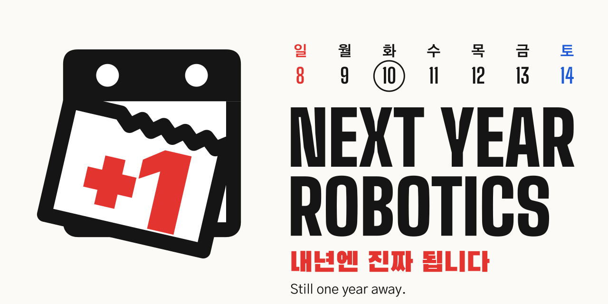
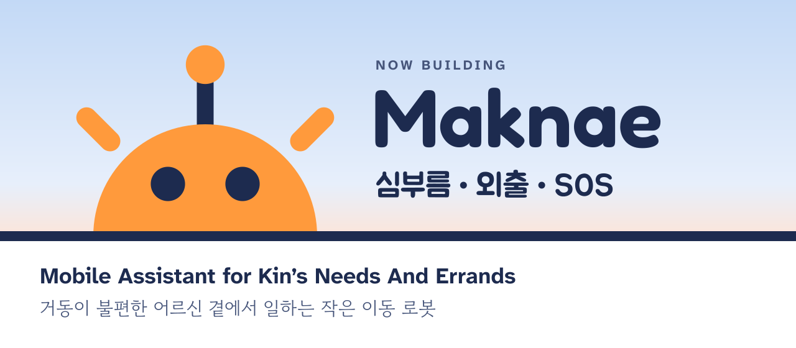

  

**"Robotics will be solved next year."** We have heard it every year since 2016.

| Year | What happened | Robotics solved? |
| --- | --- | --- |
| 2016 | AlphaGo beats Lee Sedol | Next year |
| 2017 | The Transformer paper, "Attention Is All You Need" | Next year |
| 2018 | OpenAI's Dactyl hand learns dexterity entirely in simulation | Next year |
| 2019 | Dactyl solves a Rubik's Cube with one hand | Next year |
| 2020 | GPT-3 | Next year |
| 2021 | Boston Dynamics' Atlas runs a parkour course | Next year |
| 2022 | ChatGPT. SayCan and RT-1 bring language and transformers to robots | Next year |
| 2023 | ALOHA and ACT, Diffusion Policy, and RT-2, the first VLA | Next year |
| 2024 | Mobile ALOHA, OpenVLA, π0 | Next year |
| 2025 | Gemini Robotics, GR00T N1, Helix, π0.5 | Next year |
| 2026 | Next Year Robotics starts building Maknae | **Next year. For real this time.** |

This organization is named after that year. We build open robots end to end: frame CAD, boards and firmware, ROS 2, and the apps people use around the robot.

## Now building

**Maknae** (Mobile Assistant for Kin's Needs And Errands) is a small mobile robot for older adults who have trouble getting around. It brings things like a water bottle or glasses at home, walks along with the person outside, and lets family know when something goes wrong.

| Repository | What it is |
| --- | --- |
| [mobile-robot](https://github.com/next-year-robotics/mobile-robot) | The robot: frame CAD, base interface board, STM32 firmware, and ROS 2 packages on the Raspberry Pi 5 |
| [senior-care-android](https://github.com/next-year-robotics/senior-care-android) | Android app that talks to the robot: pick a destination, start and stop a trip, answer SOS with the phone's location |
| [senior-care-dashboard](https://github.com/next-year-robotics/senior-care-dashboard) | Caregiver web dashboard for robot status, care events and SOS, with push notifications ([open](https://senior-care-dashboard.vercel.app)) |
| [mobile-robot-booth](https://github.com/next-year-robotics/mobile-robot-booth) | Exhibition booth dashboard: live camera, ArUco markers, digital twin, system status and a talking avatar |
